<h1 align="center">SmartKnob</h1>

<p align="center">
  A programmable force-feedback knob for your computer. Custom motor-driver PCB, closed-loop haptic firmware,<br>
  a native Windows companion app and a parametric 3D-printed enclosure, all designed in house.
</p>

<p align="center">
  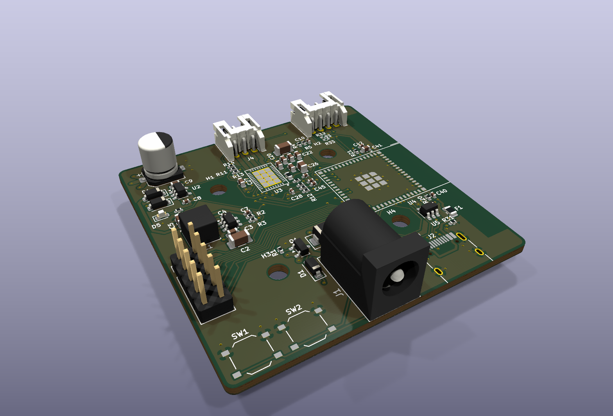
  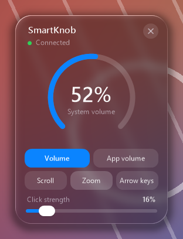
</p>

A brushless gimbal motor sits under the knob. By driving it with the right torque at every angle, the firmware makes
the same physical knob feel like a stepped volume dial, a smooth scroll wheel or a switch with hard end stops, and
changes that feel on the fly as you switch tasks on the PC. The knob talks to a small Windows tray app over USB or
Bluetooth LE, and works on its own as a media volume knob when the app isn't running.

## Contents

- [Features](#features)
- [System overview](#system-overview)
- [Hardware: the driver PCB](#hardware-the-driver-pcb)
- [Firmware](#firmware)
- [Desktop app](#desktop-app)
- [Enclosure](#enclosure)
- [How it was built](#how-it-was-built)
- [Building and flashing](#building-and-flashing)
- [Repository layout](#repository-layout)

## Features

- **Software-defined feel.** Detent strength, steps per degree and spring end stops are pushed from the PC per mode.
- **Exact volume, not key nudges.** With the app running, the knob sets system or per-app volume to the percent, and
  follows changes made elsewhere (keyboard, Windows mixer) so the dial never drifts.
- **Five modes:** system volume, volume of the focused app, scroll, zoom, and left/right arrow keys.
- **Wired or wireless.** USB-C, or Bluetooth LE from the 12 V barrel jack alone. The app switches between them
  automatically and prefers the cable.
- **Works without the app** as a USB or Bluetooth HID volume knob.
- **Liquid Glass style UI** rendered in software by a 280 KB native executable that uses no CPU while idle.

## System overview

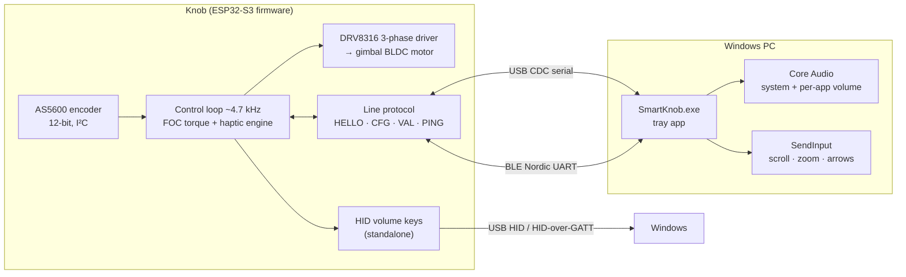

The haptics always run on the knob, so the feel never waits on the PC. The app only sends a *haptic config* (range,
degrees per step, detent strength, wall stiffness) when the mode changes, and receives value changes back.

## Hardware: the driver PCB

<p align="center">
  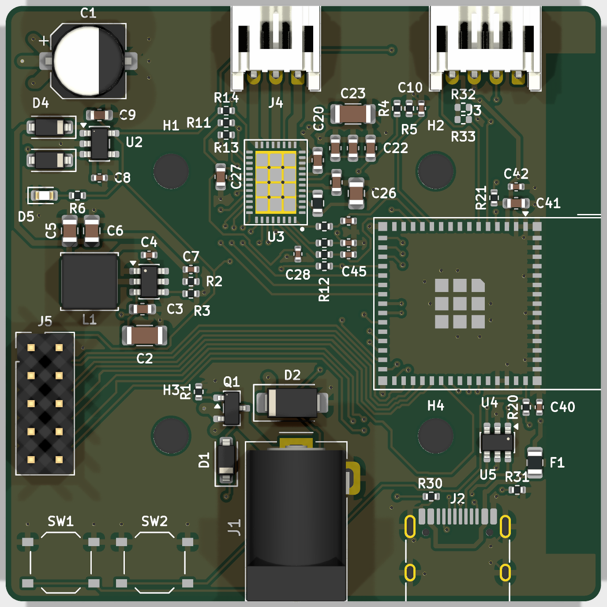
  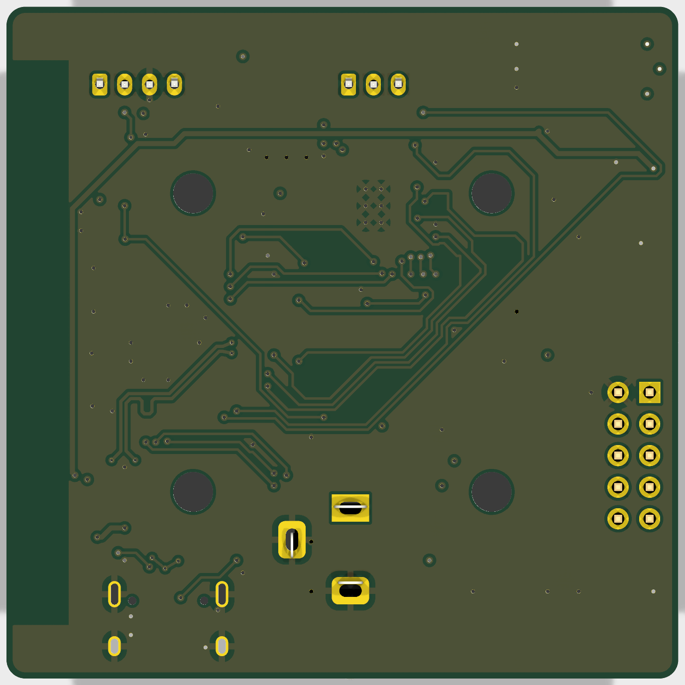
</p>

A 54 × 54 mm, four-layer board designed in KiCad. The motor's axis sits at the board centre, the AS5600 encoder board
stacks above it on M3 standoffs, and the motor mounts on top of that.

| Block | Part | Notes |
|---|---|---|
| MCU | ESP32-S3-MINI-1-N8 | Native USB (no USB-UART bridge), BLE 5, 8 MB flash |
| Motor driver | TI DRV8316CR | 3-phase, integrated FETs, SPI config, 3× PWM mode, current-sense outputs |
| Encoder | AS5600 breakout | 12-bit magnetic angle over I²C, on its own board under the motor |
| Motor | 34.5 mm gimbal BLDC | 7 pole pairs (measured during bring-up) |
| 12 V input | DC barrel jack | P-MOSFET reverse-polarity block, 15 V gate clamp, SMAJ16A TVS |
| 5 V | TI TPS54202 buck | 12 V → 5.08 V, diode-ORed with USB VBUS |
| 3.3 V | AP2112K LDO | MCU, encoder and breakout header |
| USB-C | HRO TYPE-C-31-M-12 | 500 mA polyfuse, USBLC6 ESD protection |
| Misc | | JST-PH motor and encoder connectors, 2×5 breakout header, BOOT/RESET buttons, VM voltage sense |

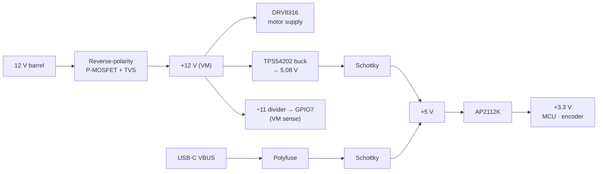

The two 5 V sources are diode-ORed, so the logic runs from either USB or the barrel jack. Motor power only comes
from the barrel jack, so on USB alone the knob still reads the encoder and talks to the PC, and the firmware turns
haptics off until 12 V is present.

**Layer stack.** Signals on the outer layers, a solid ground plane on inner 1 under everything, and inner 2 split
between the 12 V motor supply and 3.3 V. The DRV8316's thermal pad drops straight into the ground plane through a via
array, and the ESP32 antenna overhangs a copper keep-out.

<p align="center">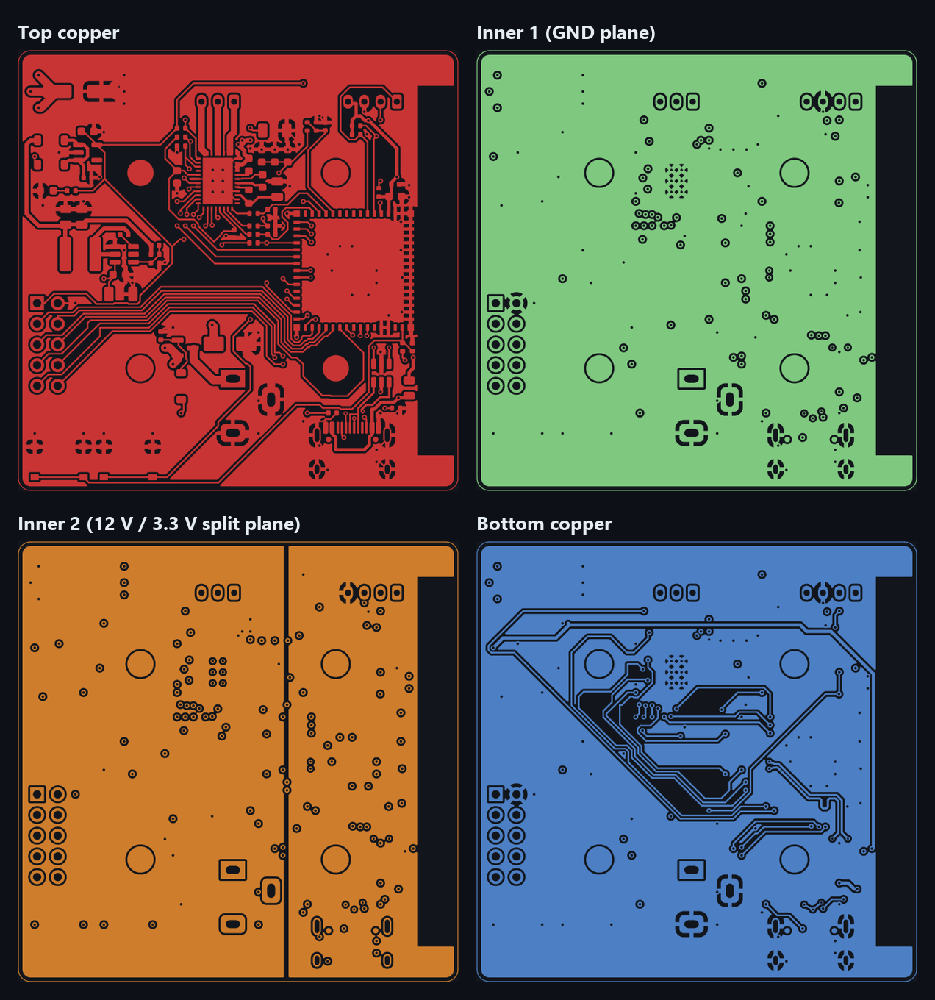</p>

<details>
<summary><b>Schematic sheets</b> (hierarchical: power, driver, MCU, connectors)</summary>

The design notes on each sheet record the datasheet decisions: feedback divider values, which DRV8316 pins may not
float, strapping pins to avoid, ADC1-only analog inputs because ADC2 is unusable with the radio on, and so on.

**Power**
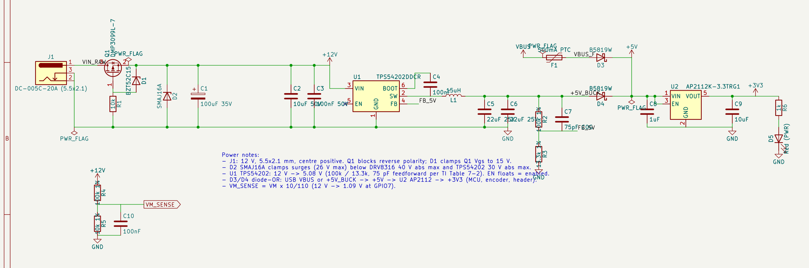

**Motor driver**
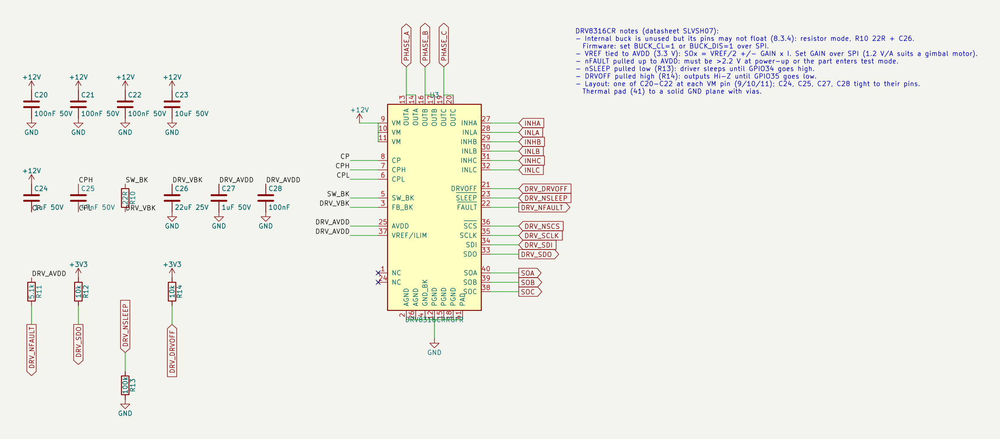

**MCU**
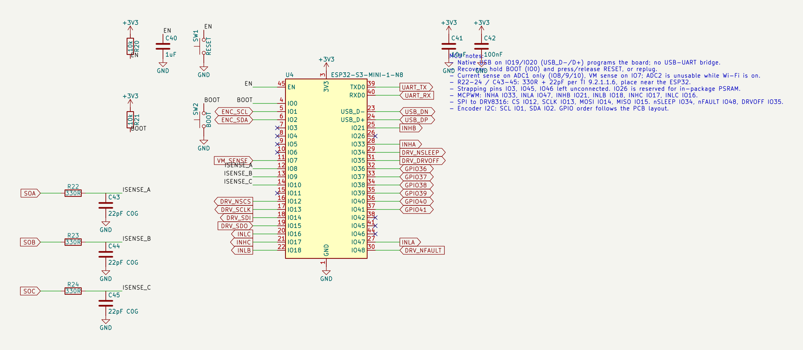

**Connectors**
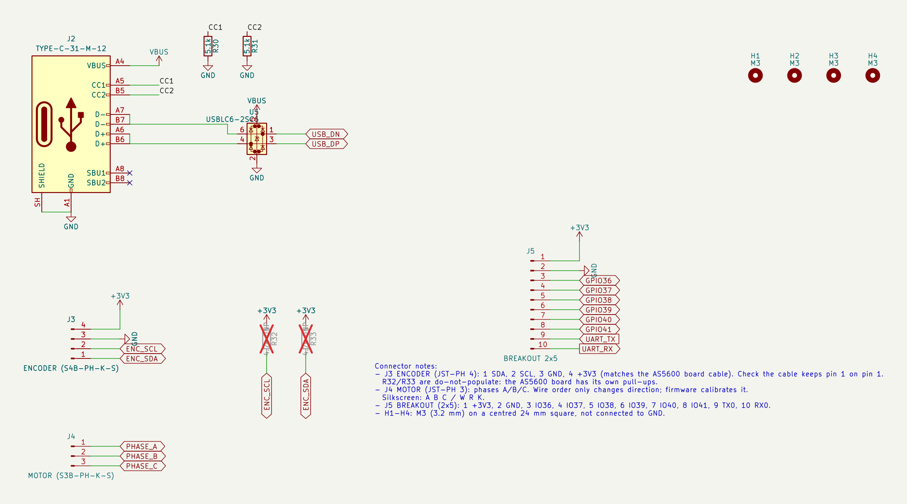

Full PDF: [hardware/smartknob_driver/smartknob_driver_schematic.pdf](hardware/smartknob_driver/smartknob_driver_schematic.pdf)
</details>

**Fabrication.** [`hardware/smartknob_driver/fab`](hardware/smartknob_driver/fab) has Gerbers, drill files and a
JLCPCB assembly BOM and placement file with LCSC part numbers, so the board can be ordered fully assembled.

## Firmware

[`volume_knob/src/main.cpp`](volume_knob/src/main.cpp) · Arduino on ESP32-S3 via PlatformIO

**Motor control.** At power-up the firmware calibrates itself: it aligns the rotor with a fixed voltage vector to find
the encoder direction and the electrical zero, then applies a test push to learn the torque sign. After that it runs
voltage-mode field-oriented control: every loop it reads the encoder over 400 kHz I²C, computes the electrical angle,
and puts the requested torque on the q-axis through 20 kHz PWM. The loop runs at about 4.7 kHz. Drive voltage is
capped per supply (3 V on 12 V, 1.2 V when VM is low), and a DRV8316 fault or loss of motor power drops the knob
into plain-encoder mode instead of driving blind.

**Haptic engine.** The knob tracks an integer value in `[lo, hi]` with one value every `step` degrees. Around each
value a capped spring pulls the knob to the detent centre, and past either end a stiffer spring wall pushes it back,
with damping on both. Hysteresis on the step boundary stops the value chattering.

<p align="center">
  <picture>
    <source media="(prefers-color-scheme: dark)" srcset="docs/images/haptic_profile_dark.png">
    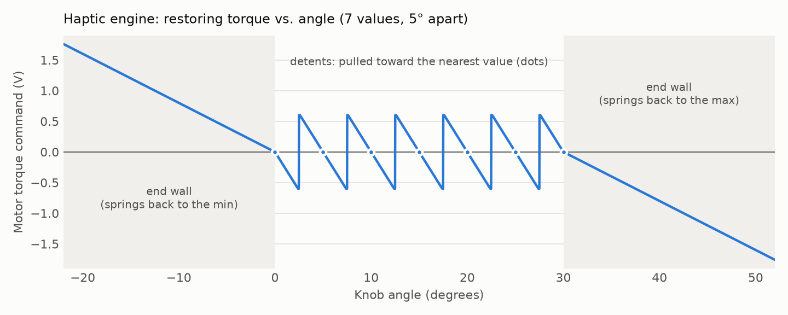
  </picture>
</p>

**Two ways to run.**

- *Host mode:* the app sends a haptic config per mode and the knob streams value changes back.
- *Standalone:* with no app for 3 s, the knob becomes a media-key volume knob. HID can only nudge the volume, so on
  connect it drives Windows to 0 % and back up to a known level, unless the app reported the real level shortly before
  it went away.

**Protocol.** Plain text lines, identical over USB serial and Bluetooth:

| Direction | Message | Meaning |
|---|---|---|
| PC → knob | `HELLO` | Handshake, answered with `INFO name=SmartKnob fw=2 hap=<0/1>` |
| PC → knob | `CFG lo= hi= val= step= det= wall=` | Range, current value, degrees per step, detent volts, wall stiffness |
| PC → knob | `VAL v=` | Move the value without moving the knob (volume changed elsewhere) |
| PC → knob | `PING vol=` | Keep-alive (3 s timeout) plus the PC's real volume, answered with `PONG hap= vm=` |
| knob → PC | `VAL v=` | The user turned the knob |

**Connectivity.** USB enumerates as a composite device (HID consumer control + CDC serial) with its own product ID.
Over Bluetooth LE the knob exposes two services on one connection: HID-over-GATT for the standalone volume keys and
the Nordic UART Service for the protocol. Every message the firmware prints goes to both transports.

## Desktop app

[`desktop/smartknob.cpp`](desktop/smartknob.cpp) · C++17, Win32, GDI+, C++/WinRT

<table>
  <tr>
    <td></td>
    <td>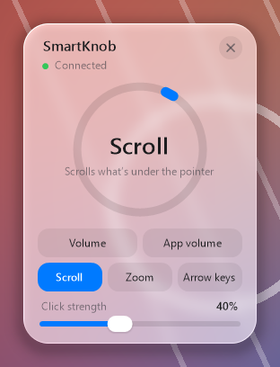</td>
  </tr>
  <tr>
    <td colspan="2" align="center">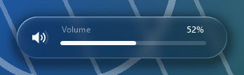<br><sub>Volume popup shown while turning</sub></td>
  </tr>
</table>

A tray app with a floating panel for picking the mode and click strength, and a volume popup that appears while you
turn the knob.

- **Volume:** sets the Windows master volume exactly through Core Audio (`IAudioEndpointVolume`), and listens for
  changes made elsewhere so the knob's haptic position stays in sync. It tags its own writes so it can ignore them.
- **App volume:** follows the foreground window (`SetWinEventHook`) and adjusts every audio session of that process.
- **Scroll / Zoom / Arrow keys:** relative modes that emit wheel events, Ctrl+wheel or ←/→ through `SendInput`, each
  with its own detent feel.
- **Connection:** finds the knob by USB ID and opens it with overlapped I/O on a reader thread. If there's no cable it
  connects to the paired knob's GATT service with C++/WinRT on a worker thread, and moves to USB as soon as a cable
  appears. The UI thread never blocks on either.

**Liquid Glass material, in software.** The panel and popup follow Apple's Liquid Glass guidelines without any GPU
framework:

- The screen behind the window is captured, downsampled, saturated and box-blurred. The windows exclude themselves from
  capture, so they never see their own pixels.
- Each pixel then gets a lens offset from the shape's signed distance field, so content bends at the rim, with slight
  chromatic dispersion, a specular rim lit from the top left, an adaptive tint and a soft shadow.
- The small popup flips light or dark with the luminance behind it, and corners are concentric (inner radius = outer
  radius − padding).
- It honours Windows dark mode, transparency effects, animation settings and high contrast.
- It only re-captures while a window is visible, and only re-renders when what's behind it changed: about 1 % of
  one core with the panel open, nothing when hidden.

**Footprint:** one 280 KB statically linked executable, no runtime to install, about 7 MB of memory, 0 % CPU idle.
Settings live in `%APPDATA%\SmartKnob\settings.ini`.

## Enclosure

<p align="center">
  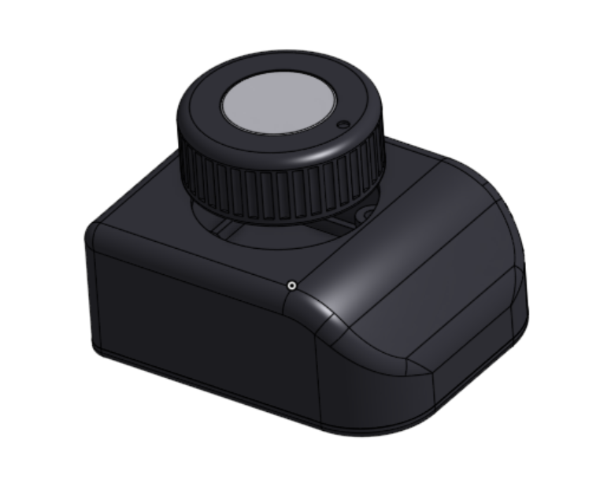
  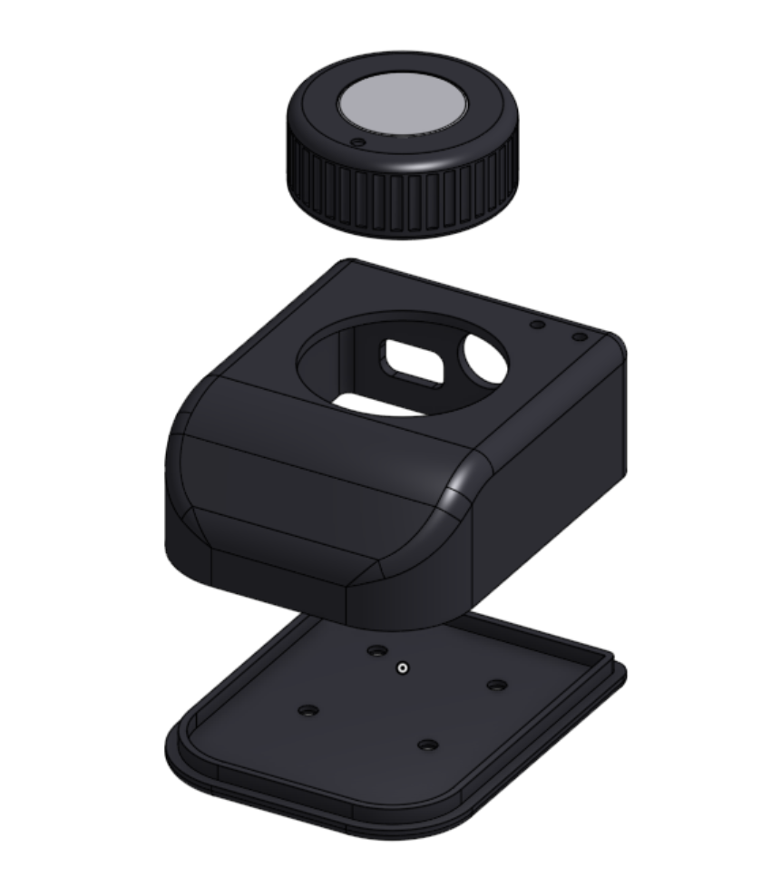
</p>

[`enclosure/smartknob_enclosure.fs`](enclosure/smartknob_enclosure.fs) · Onshape FeatureScript

The whole enclosure is a single code-defined Onshape feature, so changing a standoff height or the knob fit is one
constant and a rebuild.

- **Cover:** one printed piece. A side profile (flat deck over the motor, rounded slope down to a low nose on the
  cable side) is intersected with the plan shape, filleted along the top and shelled from the open bottom. It has
  cut-outs for the motor, barrel jack, USB-C plug and paper-clip access to BOOT/RESET.
- **Base plate:** a locating lip, and counterbored M3 holes on the board's 24 mm mounting square.
- **Encoder spacers:** printed rings that lift the AS5600 board clear of the barrel jack.
- **Knob cap:** 40 mm, 40 grip flutes and a pointer dimple. Four pegs press-fit into the rotor's M2.5 holes, with peg
  diameter as a printer-tuning constant.
- **Reference stack:** the populated PCB (built from the KiCad 3D models' bounding boxes, in the same coordinate frame
  as the KiCad STEP export), the encoder board, standoffs and motor.
- **Self-checks:** the feature measures the distance between the enclosure and everything inside it, warns on
  interference and reports the minimum clearance.

## How it was built

The whole stack was designed in house and brought up one layer at a time.

1. **Board design.** A hierarchical schematic in KiCad with datasheet decisions written onto each sheet, then a
   four-layer layout around a centred motor axis, with the JST connectors on the cable side and the power entry on
   the opposite edge. Exported Gerbers, drill files and a JLCPCB assembly BOM and placement file.
2. **Encoder bring-up.** [`encoder_test`](encoder_test/src/main.cpp) scans the I²C bus and streams raw angle,
   magnet status and AGC to confirm the magnet height.
3. **Motor bring-up.** [`motor_test`](motor_test/src/main.cpp) brings up the DRV8316 over SPI and checks supply and
   faults. It steps through the phases while watching the rotor, sweeps electrical revolutions to measure the pole
   pairs (7), and spins the motor open-loop in both directions before any closed-loop code runs.
4. **Enclosure.** Iterated in Onshape around a STEP export of the real board. Parameters live as constants rather
   than feature-dialog inputs, so pushing new code never invalidates the feature.
5. **Firmware.** Closed-loop FOC and the generic haptic engine, first as a standalone USB volume knob, then with the
   host protocol.
6. **Desktop app.** First prototyped in Python, then rewritten as a native Win32 executable to keep the memory and
   CPU footprint negligible.
7. **Bluetooth.** Added as a second transport carrying the same protocol, so the knob runs from the barrel jack alone.

**Problems found on real hardware**

- **Port mix-up.** The knob first enumerated with Espressif's default USB product ID, the same one as the chip's
  built-in flashing port, which the app deliberately never opens. The firmware now sets its own PID. Because the
  Arduino core starts USB before `setup()` when CDC-on-boot is enabled, that meant turning CDC-on-boot off and owning
  the serial object.
- **Buzzing at the end stops.** After the knob was released past 0 % or 100 %, the wall spring returned it to rest
  about 1° past the end, where friction holds it. There the wall's damping term was amplifying one-LSB encoder
  jitter, which differentiates to tens of degrees per second, into ±0.25 V of noise. That was three times the spring
  force, so the motor sat buzzing between −0.32 V and +0.17 V. A heavier velocity filter plus a 30 °/s deadband on
  the damping fixed it: the motor now holds a steady −0.07 V. A test command that shifts the knob's reference point
  made the bug reproducible on the bench without touching the knob.

## Building and flashing

**Firmware** (PlatformIO):

```sh
cd volume_knob
pio run -t upload        # first flash goes through the chip's USB-Serial/JTAG port (COM3 in platformio.ini)
```

Once the firmware is running, the board shows up as `303A:4B4E` (HID + serial) and the flashing port disappears. To
reflash, choose **Disconnect for firmware update** in the app's tray menu, then open the knob's COM port at 1200 baud
to reboot into the bootloader. Holding BOOT while plugging in also works.

**Desktop app** (Visual Studio with the C++ workload):

```bat
desktop\build.bat
desktop\SmartKnob.exe
```

`SmartKnob.exe --snapshot <dir>` renders the panel and popup over the current screen to PNGs and exits. The UI images
in this README were made that way.

**Bluetooth:** pair "SmartKnob" once in Windows Settings → Bluetooth. Windows caches the knob's services, so after
changing them in firmware, remove the device and pair again.

## Repository layout

```
hardware/smartknob_driver/   KiCad project: schematic, 4-layer PCB, custom symbols/footprints, fab outputs
volume_knob/                 Main firmware: FOC, haptic engine, USB + BLE protocol, HID
encoder_test/                Bring-up: AS5600 over I²C
motor_test/                  Bring-up: DRV8316 + open-loop motor tests
desktop/                     Windows companion app (single C++ file + build script)
enclosure/                   Onshape FeatureScript enclosure + board STEP export
docs/images/                 README images (renders, schematic sheets, app snapshots)
```
